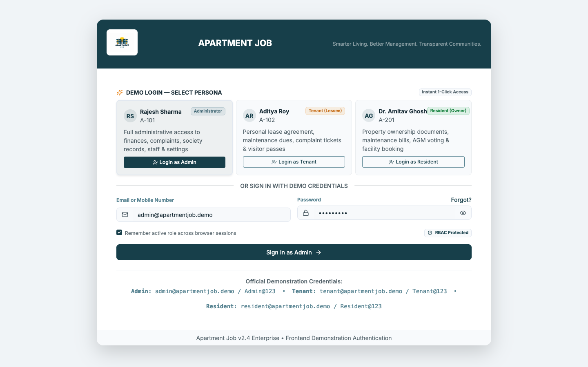
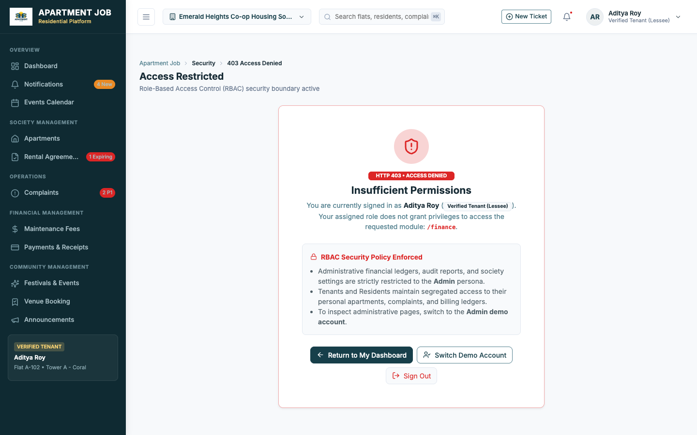
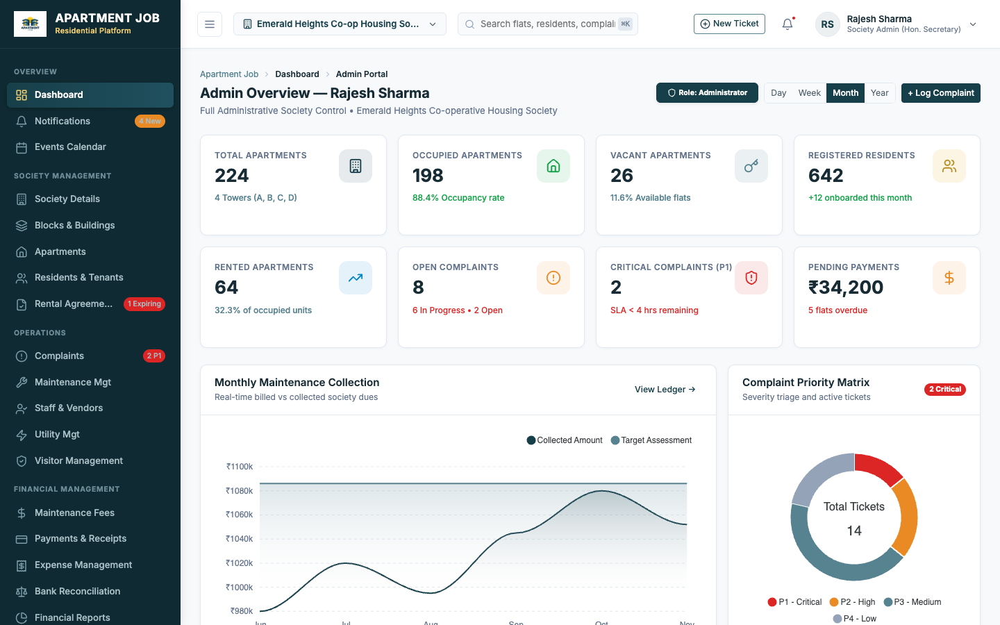
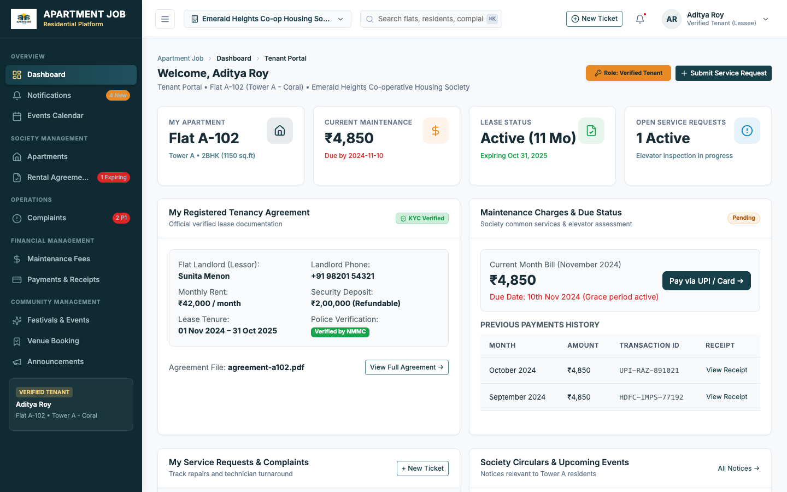
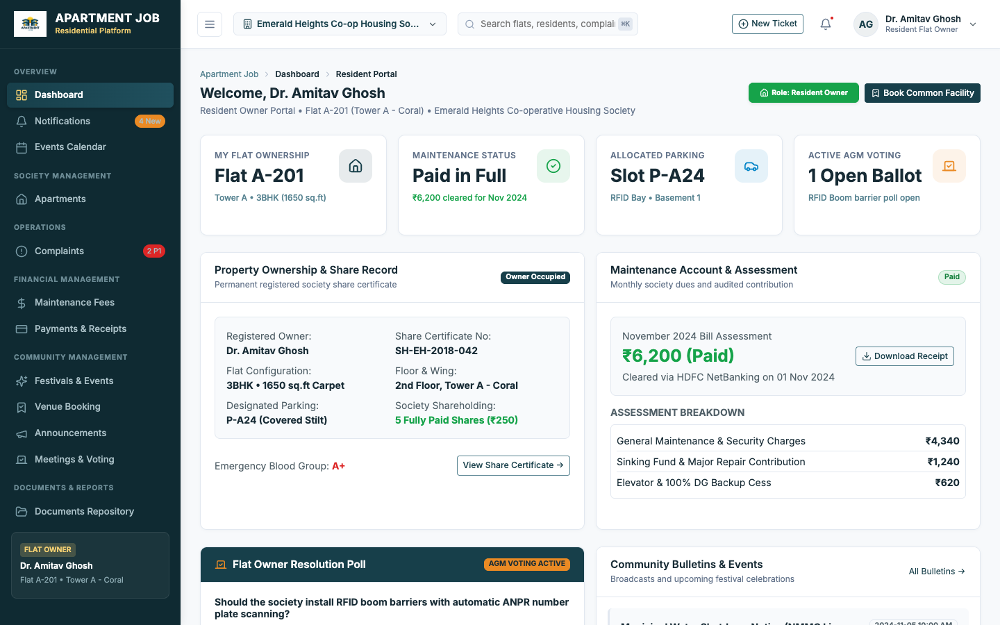
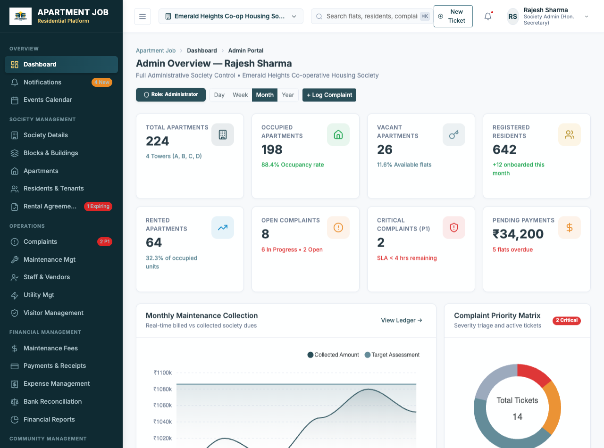
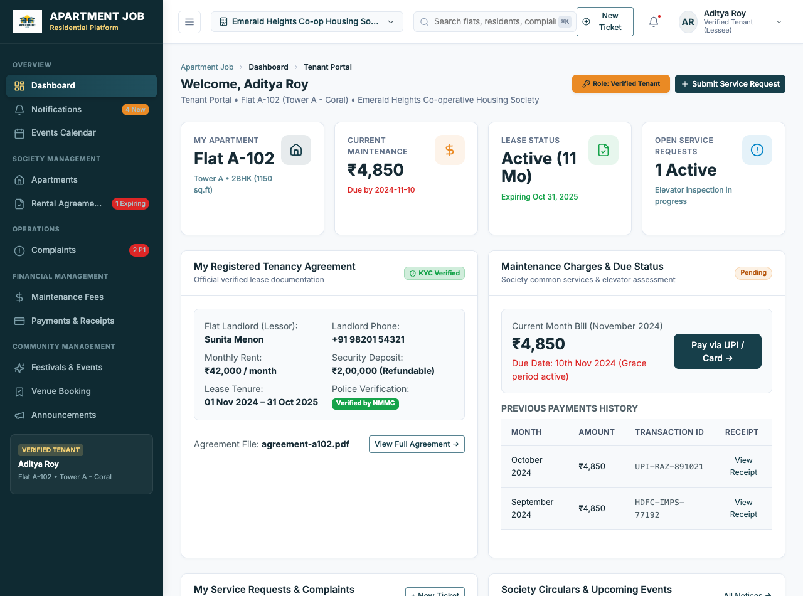
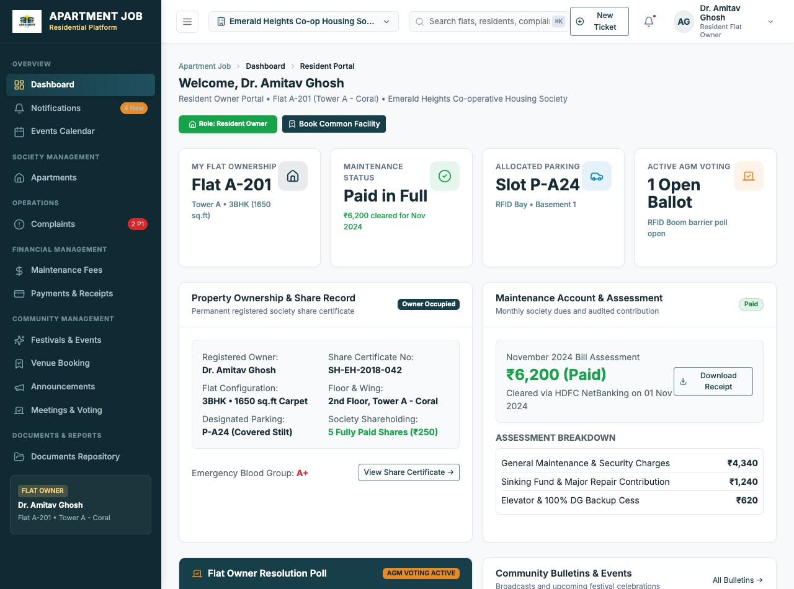

# APARTMENT JOB — Residential Society Management Platform
### UI/UX Engineering & Role-Based Access Control (RBAC) with Dastone React Admin Template

**Apartment Job** is an enterprise-grade, responsive residential society and gated community management SaaS application. Designed to replace fragmented WhatsApp groups, physical registers, and paper receipts, it unifies administrative governance, financial accounting, tenant management, facility reservations, and resident self-service into a cohesive, high-performance web dashboard.

> **Tagline:** *Smarter Living. Better Management. Transparent Communities.*

---

## 📸 Screenshots Gallery

All screenshots below are captured from the live application running on the local preview server.

### Authentication & Access Control
| View | Screenshot |
| :--- | :--- |
| **Desktop Login Screen**<br>Apartment Job branding, email/password fields, show/hide password toggle, remember me, and 3 one-click Demo Login buttons |  |
| **Unauthorized Access (403)**<br>Friendly access denied screen triggered when unauthorized roles attempt to access restricted routes |  |

---

### Role-Tailored Dashboards
| Role | Dashboard Experience |
| :--- | :--- |
| **Admin Dashboard**<br>Full society overview: 8 KPI metrics, monthly collection area charts, income vs expenses distribution, P1-P4 complaint breakdown, upcoming maintenance schedules, and recent society audit logs |  |
| **Tenant Dashboard**<br>Lessee self-service hub: Registered lease agreement terms, monthly rent & security deposit info, personal maintenance dues with one-click pay, complaint status tracker, and visitor pass manager |  |
| **Resident (Owner) Dashboard**<br>Property owner portal: Carpet area, parking allocation, share certificate number, committee AGM electronic voting poll, maintenance billing ledger, and facility reservation desk |  |

---

### Permission-Aware Navigation
| Role | Dynamic Sidebar Navigation |
| :--- | :--- |
| **Admin Navigation**<br>Unrestricted access to all 7 primary operational modules: Overview, Society Management, Operations, Financial Management, Community Management, Documents & Notices, Reports & Settings |  |
| **Tenant Navigation**<br>Scoped strictly to permitted lessee self-service modules: Overview, Operations (Complaints, Visitors), Community (Events, Facilities), and Documents (Notices, My Lease Agreement) |  |
| **Resident Navigation**<br>Scoped to homeowner functions: Overview, Society Directory, Operations (Complaints, Visitors), Financials (My Dues), Community (Events, Bookings, Voting), and Documents (Deeds, Notices) |  |

---

## 🔑 Demo Credentials & Accounts

The platform includes three pre-configured demonstration accounts accessible via one-click buttons on the `/login` screen or the quick switcher in the header user menu:

| Role | Name | Email | Password | Flat No. | Block / Wing | Scope & Permitted Modules |
| :--- | :--- | :--- | :--- | :--- | :--- | :--- |
| **Admin** | Rajesh Sharma *(Hon. Secretary)* | `admin@apartmentjob.demo` | `Admin@123` | **A-101** | Tower A - Coral | **Full Platform Access**: Society architecture, tenant approvals, financial ledgers, bank reconciliation, vendor contracts, committee voting setup, audit reports, system settings. |
| **Tenant** | Aditya Roy *(Verified Lessee)* | `tenant@apartmentjob.demo` | `Tenant@123` | **A-102** | Tower A - Coral | **Lessee Self-Service**: Personal lease contract details, maintenance dues, service tickets, visitor entry passes, event RSVPs, facility booking requests. *Restricted from society finances, admin controls, and other residents' private records.* |
| **Resident** | Dr. Amitav Ghosh *(Flat Owner)* | `resident@apartmentjob.demo` | `Resident@123` | **A-201** | Tower A - Coral | **Homeowner Portal**: Registered share certificate, parking slot (P-A24), ownership deed records, maintenance bills & receipts, AGM voting ballots, amenity reservations. *Restricted from society financial management, staff admin, and configuration.* |

---

## 🛡️ Role-Based Access Control (RBAC) Matrix

Every route and feature in Apartment Job is centrally governed by `src/config/permissions.ts`. Unauthenticated visitors are redirected to `/login`, while authenticated users attempting to access unauthorized routes are blocked by `ProtectedRoute.tsx` and redirected to `/unauthorized`.

| Route Path | Module / Feature Name | Admin | Tenant | Resident | Access Description |
| :--- | :--- | :---: | :---: | :---: | :--- |
| `/dashboard` | Main Society Dashboard | ✅ Full | ✅ Personal | ✅ Personal | Role-specific dashboard dynamically rendered |
| `/society` | Society Overview & Blocks | ✅ | ❌ | ❌ | Tower structure, unit inventory, block creation |
| `/apartments` | Flat Directory & Inventory | ✅ | ❌ | ✅ Read-only | Roster of flats, parking assignments, owner directory |
| `/residents` | Residents & Tenants Roster | ✅ Full | ❌ | ✅ Directory | Society member roster, committee designations |
| `/agreements` | Rental Agreements & Police KYC | ✅ All | ✅ Own Only | ❌ | Lease expiry warnings, police verification documents |
| `/complaints` | Complaint Ticket Desk | ✅ Triage & SLA | ✅ Own Tickets | ✅ Own Tickets | P1-P4 ticket logging, worker assignment, status feed |
| `/maintenance` | Preventive AMC Schedules | ✅ | ❌ | ❌ | Elevators, diesel generators, solar plants, fire NOC |
| `/vendors` | Staff & Vendor Management | ✅ Full | ❌ | ❌ | Plumbers, electricians, security guards, shift logs |
| `/visitors` | Gate Visitor Management | ✅ Gate Logs | ✅ Pass Gen | ✅ Pass Gen | Visitor check-in, cab entry, courier delivery clearance |
| `/finance` | Financial Dashboard & Ledgers | ✅ | ❌ | ❌ | Society balance sheet, reserve funds, cash flow |
| `/payments` | Maintenance Fees & Receipts | ✅ Society-wide | ✅ Own Dues | ✅ Own Dues | Flat-wise billing, payment history, digital receipts |
| `/expenses` | Expense Vouchers & Invoices | ✅ Approval | ❌ | ❌ | Payment vouchers (PV), vendor bills, dual sign-offs |
| `/reconciliation` | Bank Reconciliation | ✅ | ❌ | ❌ | Auto-match bank statements with ERP entries |
| `/events` | Festivals & Community Events | ✅ Organizer | ✅ RSVP | ✅ RSVP & Budget | Festival calendars, contributions, photo albums |
| `/bookings` | Clubhouse & Venue Booking | ✅ Approver | ✅ Requester | ✅ Requester | Banquet hall, garden, rooftop reservation desk |
| `/inventory` | Society Asset Inventory | ✅ Manage | ❌ | ❌ | Chairs, tents, audio equipment issue/return |
| `/notifications` | Circulars & Broadcasts | ✅ Author | ✅ Read | ✅ Read | Water shutdown alerts, power outages, circulars |
| `/meetings` | Meetings & Committee Voting | ✅ Chair | ❌ | ✅ AGM Voter | Managing committee minutes, AGM quorum, digital voting |
| `/documents` | Document Vault | ✅ Vault Admin | ✅ Leases | ✅ Title Deeds | Registered bye-laws, audit reports, share certificates |
| `/reports` | Analytics & Export Center | ✅ | ❌ | ❌ | PDF/Excel audit reports, defaulter lists, SLA analytics |
| `/settings` | System Settings & Roles | ✅ | ❌ | ❌ | RBAC rules, billing cycles, late fees, committee signatories |

---

## 🔒 Security Considerations: Mock Auth vs Production

> [!IMPORTANT]
> **Architecture Clarification: Frontend Demonstration Authentication**
>
> The authentication and role-based access control implemented in this codebase is a **client-side demonstration mock**. It is engineered to deliver a realistic UI/UX experience and validate role workflows prior to backend integration.
> 
> Browser-based state (`localStorage`, `sessionStorage`, and React Context) cannot enforce true cryptographic security because client-side JavaScript execution and network traffic can be manipulated in the browser developer tools.

### What is Currently Implemented (Frontend Layer):
- Centralized `AuthContext` managing active user profile, login state, and role switcher.
- Modular credential validator checking input against predefined demo accounts with descriptive errors.
- Session persistence honoring the "Remember Me" preference (`localStorage` for persistent sessions, `sessionStorage` for temporary single-tab sessions).
- Declarative `ProtectedRoute` wrapper inspecting route authorization against `src/config/permissions.ts`.
- Permission-filtered sidebar navigation dynamically pruning unauthorized modules from view.
- Clean session reset upon sign-out or account switching to prevent state contamination.
- Custom 403 `Unauthorized` route with clear contextual explanations and redirect triggers.

### What Must Be Implemented in Production (Backend API Layer):
1. **Server-Side Session / Token Validation**:
   - Issue cryptographically signed HTTP-only, secure, `SameSite=Strict` JWTs or server-side Redis session cookies upon authentication.
   - Client applications must never store sensitive JWTs or private authorization claims in unencrypted local storage.
2. **Endpoint-Level Authorization Guards**:
   - Every API route (e.g., `/api/v1/finance/ledgers`, `/api/v1/expenses`) must inspect the caller's server-verified role and claims. Never rely on the frontend to hide restricted endpoints.
3. **Multi-Tenant Data Isolation & Row-Level Security (RLS)**:
   - Tenant and Resident requests must query database records scoped strictly to `user_id` and `society_id`. Ensure a resident cannot fetch another flat's financial records by tampering with route IDs.
4. **Credential Hashing & Rate Limiting**:
   - Store passwords using modern adaptive hashing algorithms (`Argon2id` or `bcrypt` with cost factor 12+).
   - Enforce IP-based and account-based rate limiting on login endpoints to mitigate credential-stuffing and brute-force attacks.
5. **Audit Logging & Dual-Signatory Verification**:
   - High-value financial transactions (expenses > ₹25,000) should require cryptographic multi-signature approvals (Secretary + Treasurer).

---

## 🎨 Brand Identity & Dastone Template Adaptation

Apartment Job is built on top of the **Dastone React Admin Dashboard** architecture. Rather than introducing alien component libraries, the existing Dastone layout, card grid, Bootstrap 5 base, and SCSS typography are preserved and re-themed to the official Apartment Job palette:

```scss
// Primary Brand Palette
$teal-primary:    #173F4A;  // Dominant brand color: Sidebar, headers, primary buttons
$blue-gray:        #578391;  // Secondary accent: Subheadings, outlines, icons
$accent-yellow:    #F2CF72;  // Accent highlight: Badges, warnings, active pills
$bg-canvas:        #F7F9FB;  // Clean application background canvas
$card-bg:          #FFFFFF;  // High-contrast clean white surface cards
$text-primary:     #172B35;  // Ultra-readable dark slate for headings
$text-secondary:   #64748B;  // Accessible slate-gray for labels and timestamps
$border-color:     #E2E8F0;  // Clean 1px structural borders

// Status Semantics
$status-success:   #16A34A;  // Paid dues, active tenancies, resolved tickets
$status-warning:   #EA8A24;  // In-progress maintenance, expiring agreements
$status-danger:    #DC2626;  // Overdue payments, P1 critical outages, breaches
```

### Key UI/UX Design Principles:
- **Consistent Information Architecture**: Every page features a standardized `PageHeader` with breadcrumbs, action buttons, and contextual status badges.
- **Micro-Interactions**: Subtle button hover transitions, card elevation on mouseover, and collapsible navigation accordions.
- **Accessibility & Contrast**: All text and badge color combinations comply with WCAG 2.1 AA contrast ratios.

---

## 💻 Technology Stack

| Layer | Technology | Version | Purpose |
| :--- | :--- | :--- | :--- |
| **UI Framework** | React | `^18.2.0` | Declarative component hierarchy and state management |
| **Language** | TypeScript | `^5.2.2` | End-to-end static typing, interface contracts, and null-safety |
| **CSS Framework** | Bootstrap | `^5.3.3` | Responsive grid system, flex utilities, and modal primitives |
| **Pre-Processor** | Sass / SCSS | `^1.71.0` | Modular stylesheet architecture matching Dastone conventions |
| **Routing** | React Router DOM | `^6.22.0` | Client-side routing, nested layouts, and route guards |
| **Data Visualization** | ApexCharts & React-ApexCharts | `^3.46.0` | Interactive spline area, donut, and grouped bar charts |
| **Icons** | Lucide React | `^0.344.0` | Consistent, light-weight SVG vector iconography |
| **Bundler & Dev Server** | Vite | `^5.1.4` | Sub-second HMR and tree-shaken production bundling |

---

## 📁 Repository Structure

```
apartment-job/
├── public/
│   └── logo.png                        # Official Apartment Job logo
├── screenshots/                        # Live preview application screenshots
│   ├── login.png                       # Desktop login view
│   ├── mobile-login.png                # Mobile viewport login
│   ├── admin-dashboard.png             # Administrative governance dashboard
│   ├── admin-navigation.png            # Unrestricted admin navigation menu
│   ├── tenant-dashboard.png            # Lessee self-service dashboard
│   ├── tenant-navigation.png           # Scoped tenant navigation
│   ├── resident-dashboard.png          # Property owner dashboard
│   ├── resident-navigation.png         # Scoped resident navigation
│   └── unauthorized.png                # 403 Access Denied screen
├── src/
│   ├── assets/
│   │   └── logo/logo.png               # High-resolution brand asset
│   ├── components/
│   │   ├── auth/
│   │   │   └── ProtectedRoute.tsx      # Declarative RBAC route guard
│   │   ├── charts/
│   │   │   └── ApexChart.tsx           # Reusable ApexCharts wrapper
│   │   ├── common/
│   │   │   ├── Modal.tsx               # Accessible modal overlay with backdrop
│   │   │   ├── PriorityBadge.tsx       # P1-P4 priority chip component
│   │   │   ├── StatCard.tsx            # KPI metric card with trend indicators
│   │   │   └── StatusBadge.tsx         # Semantic state pill component
│   │   └── layout/
│   │       ├── Header.tsx              # Application header with quick demo switcher
│   │       ├── PageHeader.tsx          # Consistent page title & breadcrumb header
│   │       └── Sidebar.tsx             # RBAC permission-aware left navigation
│   ├── config/
│   │   └── permissions.ts              # Centralized role definitions, routes, & RBAC rules
│   ├── context/
│   │   └── AuthContext.tsx             # Auth provider, session persistence, demo users
│   ├── data/
│   │   └── mock/                       # Rich residential society mock data layer
│   │       ├── accounts.ts             # Demo accounts & credential registry
│   │       ├── apartments.ts           # Tower A-D units, carpet areas, parking slots
│   │       ├── complaints.ts           # Resident tickets with priority, SLA, and timelines
│   │       ├── events.ts               # Society festivals, budgets, and contributions
│   │       ├── finances.ts             # Bank accounts, ledger entries, expense vouchers
│   │       └── residents.ts            # Society members, blood groups, and vehicles
│   ├── layouts/
│   │   ├── AuthLayout.tsx              # Clean full-screen auth wrapper
│   │   └── MainLayout.tsx              # Responsive admin shell with collapsible sidebar
│   ├── pages/
│   │   ├── Apartments/                 # Flat directory & inventory
│   │   ├── Auth/
│   │   │   ├── Login.tsx               # Login page with demo access buttons
│   │   │   └── Unauthorized.tsx        # 403 Forbidden screen
│   │   ├── Bookings/                   # Banquet hall & amenities reservation desk
│   │   ├── Complaints/                 # Ticket desk with SLA & worker dispatch
│   │   ├── Dashboard/
│   │   │   ├── AdminDashboard.tsx      # Comprehensive society management overview
│   │   │   ├── Dashboard.tsx           # Smart router dispatching role-tailored dashboard
│   │   │   ├── ResidentDashboard.tsx   # Owner portal (deed, AGM vote, maintenance)
│   │   │   └── TenantDashboard.tsx     # Tenant portal (lease, dues, tickets, passes)
│   │   ├── Documents/                  # Bye-laws, NOCs, share certificates
│   │   ├── Events/                     # Festival budgets & community registrations
│   │   ├── Expenses/                   # Payment vouchers & dual approvals
│   │   ├── Finance/                    # Balance sheets & cash flow analytics
│   │   ├── Inventory/                  # Community equipment issue/return
│   │   ├── Maintenance/                # AMC schedules (Lifts, DG, Water tanks)
│   │   ├── Meetings/                   # Managing committee quorums & digital voting
│   │   ├── Notifications/              # Circulars, power cuts, water notices
│   │   ├── Payments/                   # Maintenance fee collection & receipt generation
│   │   ├── Reconciliation/             # Bank statement automated reconciliation
│   │   ├── RentalAgreements/           # Tenancy leases & police verification status
│   │   ├── Reports/                    # Financial, occupancy & SLA audit exports
│   │   ├── Residents/                  # Member directory & emergency contacts
│   │   ├── Settings/                   # Society configuration & role parameters
│   │   ├── Society/                    # Master profile, towers, amenities
│   │   ├── Vendors/                    # On-duty service staff & contractor ratings
│   │   └── Visitors/                   # Security gate check-in & delivery logs
│   ├── styles/                         # Modular SCSS styling system
│   │   ├── _animations.scss            # Dropdown entrance & badge pulse animations
│   │   ├── _header.scss                # Top navbar styling & dropdown menus
│   │   ├── _layout.scss                # Container offsets & responsive breakpoints
│   │   ├── _sidebar.scss               # Collapsible Dastone navigation styles
│   │   ├── _variables.scss             # Theme color tokens & typography
│   │   └── index.scss                  # Primary SCSS entry bundle
│   ├── types/
│   │   └── index.ts                    # Global TypeScript interfaces & data models
│   ├── App.tsx                         # Central router with protected route wrappers
│   ├── main.tsx                        # React DOM root initialization
│   └── vite-env.d.ts                   # Asset & Vite environment declarations
├── index.html                          # HTML5 template entry
├── package.json                        # Scripts and dependencies
├── tsconfig.json                       # TypeScript compiler configuration
└── vite.config.ts                      # Vite build & chunking configuration
```

---

## 🚀 Installation & Local Development

### Prerequisites
- **Node.js**: `v18.0.0` or higher (Recommended: LTS v20.x)
- **Package Manager**: `npm` (v9+) or `yarn` / `pnpm`

### 1. Clone the Repository
```bash
git clone https://github.com/your-username/apartment-job.git
cd apartment-job
```

### 2. Install Dependencies
```bash
npm install
```

### 3. Start the Development Server
```bash
npm run dev
```
Open [http://localhost:3000](http://localhost:3000) in your browser. The Vite development server features instant Hot Module Replacement (HMR).

### 4. Build for Production
```bash
npm run build
```
Executes TypeScript typechecking (`tsc`) and compiles optimized assets into `dist/`.

### 5. Preview Production Bundle Locally
```bash
npm run preview
```
Runs a local web server serving the optimized `dist/` bundle on [http://localhost:4173](http://localhost:4173).

---

## 🧩 Key Components & Patterns

### 1. `ProtectedRoute.tsx` (Route Guard)
Located at `src/components/auth/ProtectedRoute.tsx`:
```tsx
export const ProtectedRoute: React.FC<{ children: React.ReactNode; path: string }> = ({
  children,
  path,
}) => {
  const { isAuthenticated, canAccess } = useAuth();
  const location = useLocation();

  if (!isAuthenticated) {
    return <Navigate to="/login" state={{ from: location }} replace />;
  }

  if (!canAccess(path)) {
    return <Navigate to="/unauthorized" replace />;
  }

  return <>{children}</>;
};
```

### 2. `StatCard.tsx` (Metric KPI Display)
Renders high-visibility metric cards with percentage change indicators, semantic badge styling, and icons matching Dastone design standards.

### 3. `Modal.tsx` (Accessible Modal Primitive)
Provides a keyboard-accessible (`Escape` key listener), backdrop-closable dialog container used across all modules for actions like *Add Resident*, *New Complaint*, *Record Payment*, and *Upload Agreement*.

### 4. `ApexChart.tsx` (Data Visualization Wrapper)
Encapsulates ApexCharts configuration with automated dark/light theme palette binding and responsive resize listeners.

---

## 🔮 Future Enhancement Roadmap

- [ ] **Full-Stack REST / GraphQL API**: Transition from mock state to a persistent backend using NestJS or Go.
- [ ] **PostgreSQL Database with Row-Level Security (RLS)**: Enforce hardware-level multi-tenant isolation across housing societies.
- [ ] **Payment Gateway Integration**: Direct Razorpay / Stripe webhooks for instant UPI/Credit Card maintenance dues clearance with automatic GST invoice dispatch.
- [ ] **Real-Time Push Notifications**: WebSocket integration for instant gate visitor approvals and P1 emergency maintenance tickets.
- [ ] **Automated WhatsApp & SMS Notifications**: Integration with Twilio / Gupshup for water shutdown alerts and meeting circulars.
- [ ] **Hardware Gate Automation**: ANPR camera and RFID boom-barrier sync for automated resident vehicle entry.

---

## 📄 License

This project is licensed under the MIT License — see the [LICENSE](LICENSE) file for details.
